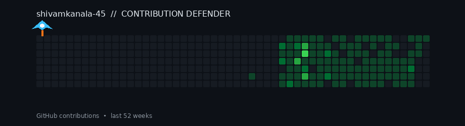
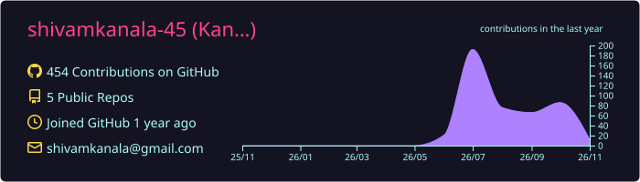
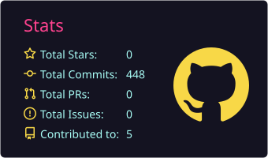
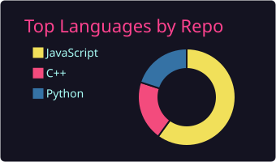
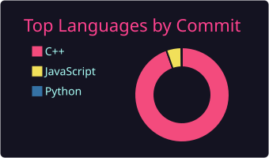
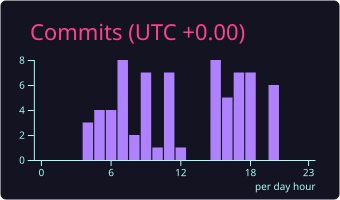

# 👋 Hi, I'm Shivam Kanala

### Problem Solver | Backend Developer in Progress

  

  
  
  

---

## 👨‍💻 About Me

- 🎓 B.Tech student in **Mathematics and Computing**.
- 🧠 Enjoy solving challenging problems and exploring algorithms.
- 💻 Currently focusing on **Backend Development**.
- 🗄️ Working with PostgreSQL and MongoDB.
- 🏗️ Interested in System Design and scalable software architecture.
- 🤖 Planning to explore Machine Learning.

I believe in understanding fundamentals, writing clean code, and learning by building real-world applications.

---

## 🧰 Tech Stack

### Programming Languages

  

### Backend Development

  

- REST API Development
- Middleware and Request Validation
- Error Handling
- Database Integration

### Databases

  

### Development Tools

  

---

## 🚀 Featured Projects

### 1. Campus Gardening Management System

[View Repository](https://github.com/shivamkanala-45/DBMS_PROJECT)

A centralized system designed to manage campus gardening operations, including plant records, garden sections, staff, equipment, maintenance and visitor management.

**Highlights**
- Designed a relational database with 23 normalized 3NF tables.
- Developed backend APIs using Node.js and Express.
- Integrated PostgreSQL for structured data management.
- Implemented modules for plant management, equipment, staff and maintenance.
- Includes a LocalStorage fallback when the backend is unavailable.

**Technologies:** JavaScript, Node.js, Express.js, PostgreSQL, HTML, CSS.

### 2. DevPulse – Issue Tracker

[View Project](https://github.com/shivamkanala-45/MINI_PROJECTS/tree/main/DevPulse-Issue-Tracker)

A full-stack issue tracking application designed to organize and manage software development tasks through a Kanban-style interface.

**Highlights**
- REST API development using Express.js.
- PostgreSQL connection pooling.
- Request validation using express-validator.
- Custom error classes and centralized error handling.
- Interactive issue management dashboard.

**Technologies:** Node.js, Express.js, PostgreSQL, JavaScript.

### 3. JavaScript Mini Projects

[View Repository](https://github.com/shivamkanala-45/MINI_PROJECTS)

A collection of small projects built to strengthen JavaScript fundamentals and browser interaction.

**Projects include**
- Color Changer – DOM manipulation and dynamic styling.
- BMI Calculator – Input handling and calculations.
- Digital Clock – Dynamic time updates.
- Guess the Number – Interactive game logic.

**Technologies:** HTML, CSS, JavaScript.

### 4. JavaScript Learning Repository

[View Repository](https://github.com/shivamkanala-45/JavaScript-Learning)

A learning repository containing JavaScript practice material and notes.

**Topics**
- DOM manipulation and traversal.
- Browser events and event handling.
- JavaScript fundamentals.
- Practical browser-side programming.

**Technologies:** JavaScript, HTML, Markdown.

### 5. LeetCode Solutions

[View Repository](https://github.com/shivamkanala-45/Leetcode)

A collection of algorithmic problem solutions focused on improving problem-solving skills and algorithmic thinking.

**Topics**
- Arrays and Strings
- Dynamic Programming
- Graphs and Trees
- Binary Search
- Greedy Algorithms
- Sliding Window
- Hashing and Stack

**Language:** C++

---

## 🧠 Areas of Interest

- Competitive Programming
- Data Structures and Algorithms
- Backend Engineering
- Database Design
- System Design
- Scalable Applications
- Machine Learning

## 🌱 Currently Learning

- Strengthening Backend Development fundamentals.
- Improving PostgreSQL and MongoDB skills.
- Understanding System Design concepts.
- Exploring the foundations of Machine Learning.

---

## 📈 GitHub Contribution Graph

  

---

## 👾 Contribution Space Shooter

  

---

## 📊 GitHub Statistics

  

  
  

  

  

---

### 💫 Thanks for visiting my profile!

**Always learning. Always solving. Always building.**

⭐ Feel free to explore my repositories and connect!

