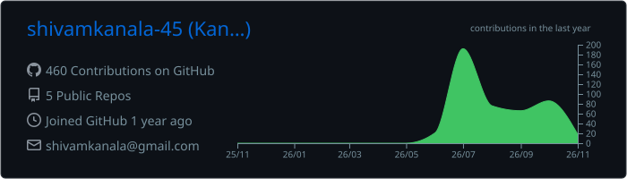
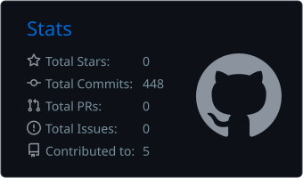
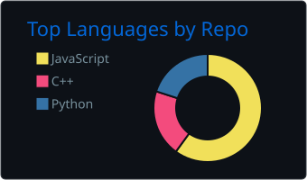
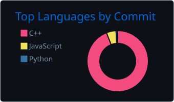
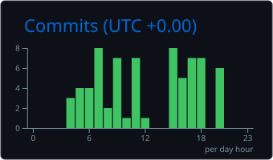

## 👨‍💻 About Me

- 🎓 B.Tech student in **Mathematics and Computing**.
- ⚙️ Interested in **backend engineering**, APIs, databases, and scalable software.
- 🌱 Exploring **Java, Spring Boot, and PostgreSQL**; previously built REST APIs with **Node.js and Express**.
- 🧠 Competitive programmer; **Codeforces Expert** and active in DSA.
- 🚀 I enjoy turning ideas into practical projects and understanding how systems work under the hood.

## 🛠️ Tech Stack

**Languages**

**Backend & Databases**

**Tools**

## 🚀 Selected Projects

| Project | What it does | Stack |
|:--|:--|:--|
| **DevPulse Issue Tracker** | REST API for tracking issues with validation, middleware and PostgreSQL integration. | Node.js, Express, PostgreSQL |
| [**Gardening Management System**](https://github.com/shivamkanala-45/DBMS_PROJECT) | Database-driven campus gardening management with staff, plant and maintenance records. | PostgreSQL, JavaScript |
| [**JavaScript Mini Projects**](https://github.com/shivamkanala-45/MINI_PROJECTS) | Small browser projects for practicing frontend fundamentals. | HTML, CSS, JavaScript |

> Some project links may need updating if your repository names differ. Add a DevPulse repository URL once published.

## 👾 Contribution Space Shooter

  
  Generated weekly from my GitHub contribution calendar.

## 📈 GitHub Activity

  

## 📊 Stats & Insights

  
  
  
  
  

  
  <b>Thanks for visiting — let's build something meaningful! 🚀</b>

